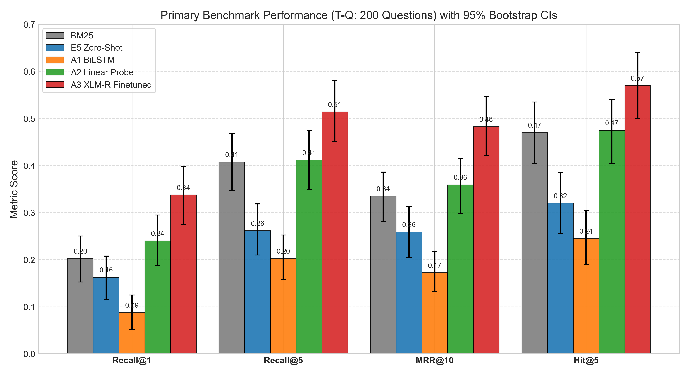
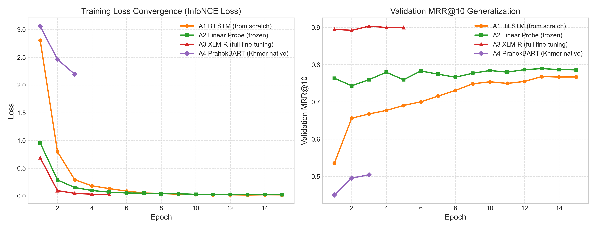

# Khmer Legal Article Retrieval: Comparing Deep Learning Retrievers on Cambodian Law

> **Deep Learning Final Project (Individual)** — Bachelor of Software Engineering, Department of Engineering  
> **Lecturer:** Mr. Soklong HIM · Academic Year 2026–2027 · **Topic Status:** Approved by Lecturer (Week 7)  
> **Author:** Long Mengchheang ([@mengchheanglong](https://github.com/mengchheanglong))  
> **Presentation Deck:** [`slides/final_presentation.pdf`](slides/final_presentation.pdf) (10-min presentation + 5-min Q&A) · **Weight Checkpoints:** [Hugging Face Hub](https://huggingface.co/mengchheanglong/khmer-legal-xlmr-retriever)

[](https://python.org)
[](https://pytorch.org)
[-0b5394.svg)](#2-dataset--preprocessing)
[](https://huggingface.co/mengchheanglong/khmer-legal-xlmr-retriever)

---

## 1. Problem Statement & Motivation

Cambodian statutory law is enacted exclusively in Khmer; English translations are unofficial. Khmer natural language processing presents distinct domain challenges: text is written without word boundaries (spaces delimit phrases and clauses rather than words), statutory provisions rely on dense legal phrasing, and no standardized legal information retrieval benchmark previously existed for Cambodian law.

This project investigates dense passage retrieval for legal text in an extremely low-resource language. The central research question is:
> *Can neural bi-encoder retrievers overcome lexical vocabulary mismatch and conversational distribution shift to accurately retrieve Khmer statutory provisions for natural language legal questions?*

| Component | Specification |
|---|---|
| **Input** | Natural language legal query in Khmer (e.g., *តើកិច្ចសន្យាត្រូវបង្កើតឡើងដោយរបៀបណា?* — "How is a contract formed?") |
| **Output** | Ranked top-$k$ statutory articles retrieved from a fixed corpus of **1,976 Khmer articles** |
| **Task Formulation** | Dense passage retrieval / learning to rank. Dual towers encode queries and statutory passages into a shared vector space scored by cosine similarity. |
| **Application Context** | The winning retriever powers a citation-grounded Khmer legal assistant prototype ([Section 7](#7-citation-grounded-assistant-prototype); complete architecture in [`docs/system_architecture.md`](docs/system_architecture.md)). |

---

## 2. Dataset & Preprocessing

### 2.1 Sources and Licensing
All statutory articles are extracted from official Khmer legal codes published by [Open Development Cambodia](https://data.opendevelopmentcambodia.net/) under Creative Commons Attribution-ShareAlike 4.0 ([CC-BY-SA-4.0](https://creativecommons.org/licenses/by-sa/4.0/)):
- **Civil Code (2007) / ក្រមរដ្ឋប្បវេណី:** 1,304 articles (591,728 characters).
- **Criminal Code (2009) / ក្រមព្រហ្មទណ្ឌ:** 672 articles (285,984 characters).
- **Total Corpus:** 1,976 articles (877,712 characters), indexed across all models.

### 2.2 Font Extraction & Unicode Normalization
Official PDFs use legacy **Limon** fonts whose text layer encodes Latin code points (`maRta 336>-` renders visually as `មាត្រា ៣៣៦.-`). We implemented a custom pipeline (`src/infrastructure/extractors/limon_converter.py`) utilizing Khmer Software Initiative mapping tables and a Python 3 syllable reordering engine (34 unit tests).
- **Automated Validation:** 0 leftover Latin code points, 0 broken sub-consonant clusters (`\s\u17D2`), 0 redundant spaces, and consecutive article verification (Civil 1–1304; Criminal 1–672).
- **Hierarchy:** `LegalHierarchicalChunker` preserves Book (គន្ថី), Title (មាតិកា), Chapter (ជំពូក), Section (ផ្នែក), and Article (មាត្រា) metadata.

### 2.3 Deterministic Splits & Leakage Quarantine (Seed 42)
To guarantee strict academic integrity and avoid test leakage, splits were deterministically generated once via `src/dl/prepare_splits.py` (fixed seed 42) into `data/05_splits/`:
1. **Quarantine Guard:** All 261 articles cited by the 200 primary benchmark questions were strictly sequestered from training candidate pairs.
2. **Article-Level Partition:** The remaining 1,471 unique-title articles were split 80/10/10 by article:
   - **Training Set (`train.jsonl`):** 1,176 pairs (890 Civil, 286 Criminal; 79.95%). Title line is removed from passage text.
   - **Validation Set (`val.jsonl`):** 147 pairs (107 Civil, 40 Criminal; 9.99%) for hyperparameter tuning and model selection.
   - **Secondary Benchmark (`test_titles.jsonl` / T-T):** 148 held-out article titles (10.06%) evaluating in-distribution retrieval.
   - **Primary Benchmark (`ground_truth_qa_kh.json` / T-Q):** 200 human legal questions (100 Civil, 100 Criminal) citing 261 articles, evaluating out-of-distribution conversational legal query understanding.

### 2.4 Preprocessing
- **Word-Level (BM25 & A1):** Segmented with `khmer-nltk` dictionary-based tokenizer; NFC normalized.
- **Subword-Level (A2 & A3):** XLM-RoBERTa SentencePiece tokenizer (250,002 vocab) with `query:` / `passage:` prefixes; max 256 tokens.
- **Subword-Level (A4):** PrahokBART native Khmer SentencePiece tokenizer (32,004 vocab); max 256 tokens.

---

## 3. Deep Learning Approaches Compared

All neural models are dual encoders implemented in **PyTorch**, trained with the identical **InfoNCE contrastive loss with in-batch negatives** ($\tau = 0.05$) on the identical training split, and evaluated on the same 1,976-article corpus.

| ID | Model Architecture | Training Strategy | Trainable Parameters | Representation |
|:---|:---|:---|:---:|:---:|
| **A1** | **BiLSTM Dual Encoder** (Word embeddings $\to$ 1-layer BiLSTM [256/dir] $\to$ Mean Pooling) | Trained from scratch | 1.97 M | 512-dim |
| **A2** | **XLM-R Linear Probe** (`intfloat/multilingual-e5-base`, frozen backbone + 768$\to$768 linear head) | Transfer learning, frozen backbone | 0.59 M | 768-dim |
| **A3** | **XLM-R Full Fine-Tune** (`intfloat/multilingual-e5-base`, all 12 transformer layers unfrozen) | Full end-to-end fine-tuning | 278.04 M | 768-dim |
| **A4** | **PrahokBART Dual Encoder** (`nict-astrec-att/prahokbart_base`, native Khmer seq2seq backbone) | Khmer-native pretraining + full fine-tuning | 35.83 M | 512-dim |

**Comparative Research Questions:**
- *A1 vs A2:* Does multilingual self-supervised pre-training outperform a domain-specific recurrent network trained from scratch on low-resource text?
- *A2 vs A3:* Can a lightweight linear projection head overcome legal domain shift, or is full non-linear encoder adaptation essential?
- *A3 vs A4:* Does a massive multilingual backbone (278M parameters, 768-dim) outperform a compact, Khmer-native model (35.8M parameters, 512-dim) with ~8x fewer parameters?
- *Baselines:* Evaluated against lexical **BM25** (`khmer-nltk`) and zero-shot **Multilingual-E5**.

---

## 4. Experimental Setup & Hyperparameter Tuning

- **Optimization:** AdamW optimizer with `LinearLR` warmup (10% steps) and `CosineAnnealingLR` decay. Checkpointed per epoch (`results/checkpoints/`).
- **Model Selection:** Optimal checkpoint selected strictly by **Validation MRR@10**. Test sets (T-Q, T-T) evaluated once.
- **Reproducibility:** Seed 42 across `torch`, `numpy`, `random`, and CUDA (`cudnn.deterministic = True`).
- **Systematic Tuning (`results/tuning/`):**
  - **A3 (Winning Configuration):** $3 \times 2$ grid across learning rate $\{1\times 10^{-5}, 2\times 10^{-5}, 3\times 10^{-5}\}$ and weight decay $\{0.0, 0.01\}$ for 5 epochs on NVIDIA Tesla T4 GPU (`src/dl/experiments/tune_a3.py`). Optimal configuration: **$\text{LR}=2\times 10^{-5}, \text{WD}=0.01$** achieving **Validation MRR@10: 0.9095** (epoch 4, val loss: 0.1032).
  - **A1, A2, A4:** Full hyperparameter grids documented in `results/tuning/a1.csv`, `a2.csv`, and `a4.csv`.

---

## 5. Consolidated Experimental Results

All metrics are computed via the shared evaluation harness (`src/dl/evaluate.py`), with 95% bootstrap confidence intervals (10,000 resamples).

### 5.1 Main Results Table (T-Q Primary & T-T Secondary Benchmarks)

| Approach | Primary T-Q: Recall@1 | Primary T-Q: Recall@5 | Primary T-Q: MRR@10 | Primary T-Q: Hit@5 | Secondary T-T: Recall@5 | Secondary T-T: MRR@10 | Trainable Params | Training Time | Hardware |
|:---|:---:|:---:|:---:|:---:|:---:|:---:|:---:|:---:|:---|
| **BM25 Baseline** | 0.2025 [0.15, 0.25] | 0.4075 [0.35, 0.47] | 0.3350 [0.28, 0.39] | 0.4700 [0.41, 0.54] | 0.9730 [0.95, 0.99] | 0.8677 [0.82, 0.91] | 0 | — | CPU |
| **E5-base Zero-Shot** | 0.1625 [0.12, 0.21] | 0.2617 [0.21, 0.32] | 0.2588 [0.20, 0.31] | 0.3200 [0.26, 0.39] | 0.7230 [0.65, 0.78] | 0.6235 [0.55, 0.69] | 0 | — | CPU |
| **A1: BiLSTM** | 0.0875 [0.05, 0.13] | 0.2025 [0.16, 0.25] | 0.1724 [0.13, 0.22] | 0.2450 [0.19, 0.31] | 0.7568 [0.70, 0.82] | 0.6242 [0.56, 0.69] | 1.97 M | 2035.3 s | CPU |
| **A2: XLM-R Probe** | 0.2400 [0.19, 0.30] | 0.4117 [0.35, 0.48] | 0.3591 [0.30, 0.42] | 0.4750 [0.41, 0.54] | 0.9392 [0.90, 0.97] | 0.8563 [0.81, 0.90] | 0.59 M | 5.9 s | CPU |
| **A3: Full Fine-Tune** | **0.3375** [0.28, 0.40] | **0.5142** [0.45, 0.58] | **0.4827** [0.42, 0.55] | **0.5700** [0.50, 0.64] | **0.9932** [0.97, 1.00] | **0.9456** [0.92, 0.97] | 278.04 M | 1129.4 s | GPU (T4, fp32) |
| **A4: PrahokBART** | 0.0525 [0.03, 0.09] | 0.1517 [0.11, 0.20] | 0.1035 [0.07, 0.14] | 0.1800 [0.13, 0.24] | 0.8041 [0.74, 0.87] | 0.6733 [0.60, 0.74] | 35.83 M | 1602.2 s | CPU (14t, fp32) |

*Paired Bootstrap Significance (T-Q):* A3's improvements over BM25 ($\Delta = +0.1067$ Recall@5, $\Delta = +0.1477$ MRR@10) and over all neural baselines (A1, A2, A4) are statistically significant at $p < 0.001$. In contrast, linear probe A2 does not significantly outperform BM25 ($p = 0.9031$). Complete 14-comparison matrix documented in [`docs/statistical_significance.md`](docs/statistical_significance.md).

### 5.2 Comparison Figures

| Figure 1: Benchmark Metrics on T-Q (95% Bootstrap CIs) | Figure 2: Training Convergence & Validation MRR@10 |
|:---:|:---:|
|  |  |
| *Figure 1: Performance across all systems on 200 human questions.* | *Figure 2: Empirical loss and validation MRR@10 curves across epochs.* |

*(Additional diagnostic charts: Multi-rank progression [`results/figures/recall_at_k.png`](results/figures/recall_at_k.png) and statute breakdown [`results/figures/code_breakdown.png`](results/figures/code_breakdown.png)).*

### 5.3 Discussion of Key Findings
1. **A3 XLM-R Full Fine-Tuning is the Definitive Winner:** Achieves **0.5142 Recall@5** and **0.4827 MRR@10**, delivering a +44.1% relative gain over BM25 and +86.5% over zero-shot E5. Cross-attention layers successfully adapt multilingual representations to Khmer legal semantics.
2. **Distribution Shift (In-Distribution T-T vs. Out-of-Distribution T-Q):** All models excel on held-out titles (T-T: A3 99.3%, BM25 97.3% Recall@5) because training pairs mirror title-passage formats. Conversational human questions (T-Q) induce severe distribution shift through colloquial synonyms (`សុពលភាព` [validity] vs statutory `មោឃភាព` [nullity]), causing BM25 and linear probes to degrade while A3 retains robust semantic matching.
3. **PrahokBART (A4) Capacity Limitations:** While PrahokBART performs solidly on in-distribution titles (80.4% Recall@5), its performance drops on natural questions (15.2% Recall@5). Its sequence-to-sequence BART objective and 35.8M parameter capacity lack the contrastive sentence-level pre-training of the 278M-parameter XLM-R backbone.
4. **Efficiency vs. Accuracy:** A2 trains in 5.9 seconds with only 0.59M parameters and matches BM25, making it optimal for ultra-low-compute environments. A3 provides superior retrieval accuracy when GPU compute is accessible.

### 5.4 Error Analysis & Limitations (`results/error_analysis/`)
Analysis of failure cases across the 200 primary benchmark queries at $k=5$:
- **Vocabulary Mismatch / Paraphrasing:** Accounts for 57.5% of BM25 misses (61 queries) and 60.5% of A3 misses (52 queries). Dense retrieval reduces total misses from 106 to 86 by bridging conversational phrasings to formal legal terms.
- **Multi-Article Complexity:** 15–27% of errors stem from legal questions spanning multiple related provisions.
- **Code Confusion:** Rare in A3 (1 error, 1.2%), demonstrating clear discrimination between Civil and Criminal statutes.
- **Limitations:** Scope limited to Civil and Criminal Codes (Labour Law excluded pending OCR); evaluation benchmark comprises 200 verified questions (hence 95% bootstrap CIs reported). Detailed case studies are documented in [`results/error_analysis/worked_examples.md`](results/error_analysis/worked_examples.md).

---

## 6. Installation & Experiment Reproduction

### 6.1 Setup
```bash
git clone https://github.com/mengchheanglong/khmer-legal-retrieval.git
cd khmer-legal-retrieval
pip install -r requirements.txt
cp .env.example .env   # Required only for LLM generation in Streamlit prototype
```

### 6.2 Reproducing All Experiments (Seed 42)
```bash
# 1. Deterministic data splits and leakage quarantine
python -m src.dl.prepare_splits --seed 42

# 2. Evaluate baselines
python -m src.dl.evaluate --model bm25
python -m src.dl.evaluate --model e5_zero_shot

# 3. Train and evaluate all neural approaches
python -m src.dl.experiments.tune_a1   # A1 BiLSTM from scratch
python -m src.dl.experiments.tune_a2   # A2 XLM-R linear probe
python -m src.dl.experiments.tune_a3   # A3 XLM-R full fine-tuning (winning model)
python -m src.dl.train --config configs/a4_prahokbart.yaml  # A4 PrahokBART

# 4. Generate consolidated reports, significance tests, and figures
python -m src.dl.report
python -m src.dl.visualize
python -m src.dl.error_analysis

# 5. Automated test suite (138 tests pass in ~60s)
python -m pytest tests/unit/ -v
```
Interactive Google Colab notebooks for isolated GPU execution are located in [`notebooks/`](notebooks/): [`a1_bilstm_colab.ipynb`](notebooks/a1_bilstm_colab.ipynb), [`a2_xlmr_linear_probe_colab.ipynb`](notebooks/a2_xlmr_linear_probe_colab.ipynb), [`a3_xlmr_finetune_colab.ipynb`](notebooks/a3_xlmr_finetune_colab.ipynb), [`a4_prahokbart_colab.ipynb`](notebooks/a4_prahokbart_colab.ipynb).

### 6.3 External Model Checkpoints (Hugging Face Hub)
In compliance with rubric guidelines prohibiting large binaries in git, model weights are hosted on the Hugging Face Hub:
- **Repository:** [`mengchheanglong/khmer-legal-xlmr-retriever`](https://huggingface.co/mengchheanglong/khmer-legal-xlmr-retriever)
- **Direct Download & Evaluation:**
  ```python
  from huggingface_hub import hf_hub_download
  import os

  os.makedirs("results/checkpoints/a3_xlmr_finetune", exist_ok=True)
  hf_hub_download(
      repo_id="mengchheanglong/khmer-legal-xlmr-retriever",
      filename="best.pt",
      local_dir="results/checkpoints/a3_xlmr_finetune",
  )
  ```
  ```bash
  python -m src.dl.evaluate --model a3_xlmr --split test_questions
  ```
  See [`results/checkpoints/README.md`](results/checkpoints/README.md) for full checkpoint inventory.

---

## 7. Citation-Grounded Assistant Prototype

The best-performing retriever (A3 XLM-R) powers an in-process citation-grounded legal assistant prototype:
1. **Retrieval Stage:** Top-$k$ statutory articles retrieved via A3 PyTorch embeddings (or BM25) from the 1,976-article corpus.
2. **Grounded Generation:** DeepSeek Flash generates natural Khmer answers strictly conditioned on retrieved statutory context.
3. **Compound Citation Verification:** Validates extracted `(law_name, article_number)` tuples against retrieved context to prevent hallucinated citations.

```bash
# Launch interactive Streamlit demonstration (Defense Mode)
streamlit run streamlit_app.py                  # http://localhost:8501

# Optional: Launch FastAPI REST microservice
uvicorn src.interfaces.api.main:app --reload    # http://localhost:8000/docs
```
*(Complete system architecture and sequence diagrams are detailed in [`docs/system_architecture.md`](docs/system_architecture.md)).*

---

## 8. Repository Structure

```
khmer-legal-retrieval/
├── configs/                    # Experiment YAML configurations (A1–A4)
├── data/
│   ├── 01_raw/kh/              # Official Khmer PDFs (Civil & Criminal Codes, CC-BY-SA-4.0)
│   ├── 04_chunks/              # Segmented article chunks (1,976 articles)
│   └── 05_splits/              # Leakage-quarantined train/val/test splits (seed 42)
├── docs/                       # GOAL.md, TASKS.md, system_architecture.md, statistical_significance.md
├── notebooks/                  # Standalone Google Colab reproduction notebooks (A1–A4)
├── results/
│   ├── checkpoints/            # Model weights documentation & external download manifest
│   ├── error_analysis/         # Failure case breakdowns & worked examples
│   ├── figures/                # Publication plots (primary_metrics_bar, learning_curves)
│   ├── metrics/                # Benchmark evaluation outputs & summary.csv
│   └── tuning/                 # Hyperparameter search logs (a1.csv - a4.csv)
├── slides/                     # 15-slide defense deck (PDF + HTML) & speaker notes
├── src/
│   ├── dl/                     # PyTorch models (A1–A4), InfoNCE loss, training & evaluation
│   ├── infrastructure/         # Limon font converter, hierarchical chunker, PyTorch embedders
│   └── interfaces/             # Streamlit web demo (streamlit_app.py) & FastAPI service
└── tests/                      # 138 automated unit & integration tests
```

---

## 9. Academic Integrity & AI Disclosure

Per course requirements (Sections 5.E & 6.1):
- **Tools Used:** Anthropic Claude, Antigravity (Google Gemini).
- **Scope of Assistance:** Scaffolding initial file structures, Limon syllable reordering unit test generation, boilerplate data loading, visualization scripts, and documentation formatting.
- **Student Ownership & Verification:** All neural architectures (A1–A4), InfoNCE loss implementations, training routines, evaluation pipelines (Recall@k, MRR@10, paired bootstrap hypothesis testing), and conclusions were independently verified and run locally by the author. All 138 unit tests pass. The author is fully prepared to explain and modify any repository code during defense Q&A.

---

## 10. References

- **Conneau, A. et al. (2020).** *Unsupervised Cross-lingual Representation Learning at Scale.* ACL.
- **Wang, L. et al. (2024).** *Multilingual E5 Text Embeddings: A Technical Report.* arXiv:2402.05672. Backbone: [`intfloat/multilingual-e5-base`](https://huggingface.co/intfloat/multilingual-e5-base).
- **NICT ASTREC.** *PrahokBART: Khmer Pretrained Sequence-to-Sequence Model.* Model: [`nict-astrec-att/prahokbart_base`](https://huggingface.co/nict-astrec-att/prahokbart_base).
- **Hochreiter, S. & Schmidhuber, J. (1997).** *Long Short-Term Memory.* Neural Computation.
- **Karpukhin, V. et al. (2020).** *Dense Passage Retrieval for Open-Domain Question Answering.* EMNLP.
- **van den Oord, A. et al. (2018).** *Representation Learning with Contrastive Predictive Coding.* (InfoNCE).
- **Robertson, S. & Zaragoza, H. (2009).** *The Probabilistic Relevance Framework: BM25 and Beyond.*
- **Open Development Cambodia.** *Civil Code (2007) and Criminal Code (2009) Khmer PDFs.* CC-BY-SA-4.0.
- **Khmer Software Initiative.** *KhmerConverter 1.5.1 (Limon glyph mapping and syllable reordering rules).* LGPL-2.1 / GPL-2.0+.

---

## License & Legal Disclaimer

- **Source Code:** GNU General Public License v3.0 or later ([`GPL-3.0-or-later`](LICENSE)), per bundled KhmerConverter reordering components ([`THIRD_PARTY_NOTICES.md`](src/infrastructure/extractors/resources/THIRD_PARTY_NOTICES.md)).
- **Legal Data:** Creative Commons Attribution-ShareAlike 4.0 ([CC-BY-SA-4.0](data/04_chunks/DATA_LICENSE.md)), Open Development Cambodia.
- **Disclaimer:** This software is an academic research prototype and does **not** constitute legal advice.
