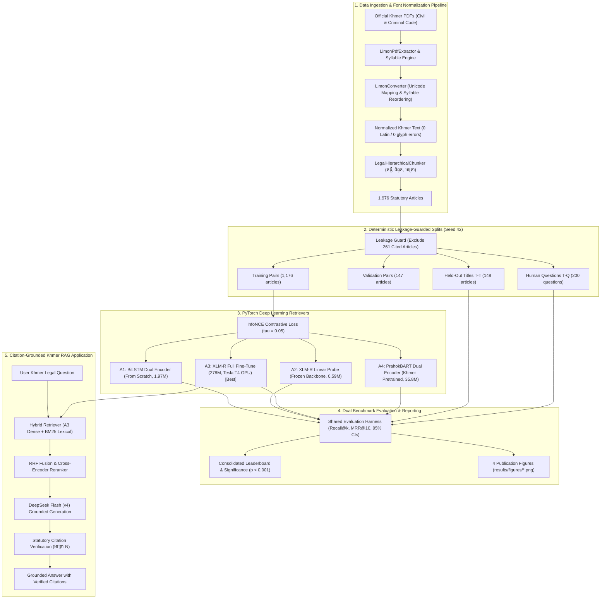
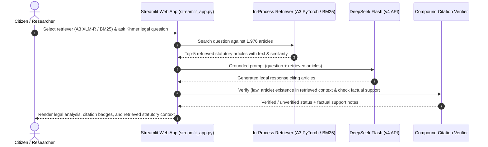

# System Architecture & Component Specification

This document details the end-to-end architecture and runtime execution models of the Khmer Legal Retrieval and Question-Answering system.

---

## 1. End-to-End Pipeline Data Flow

---

## 2. Interactive RAG Prototype Execution Path

The project provides two execution paths designed according to **Clean Architecture** principles:

### Path A: Interactive Streamlit UI (In-Process Defense Mode)
The interactive demo (`streamlit_app.py`) executes use cases directly **in-process** without requiring external database or microservice overhead:
1. **Retriever Ingestion & Model Selection:** Ingests the 1,976 Khmer statutory articles and runs local retrieval via our winning PyTorch checkpoint (Approach A3: XLM-R full fine-tune) or the lexical BM25 baseline with `khmer-nltk` tokenization.
2. **Grounded Synthesis:** Calls DeepSeek Flash (`deepseek-chat`) with strict system prompts requiring article citations (`មាត្រា N` / `(Civil Code 2007, Article N)`).
3. **Compound Citation Verification:** Verifies citations against compound `(law_name, article_number)` identifiers to avoid Civil vs Criminal article collisions, and flags whether retrieved articles provide factual support vs explicit lack-of-coverage disclaimers.
4. **Live Benchmark Audit:** Surfaces real metrics from `results/metrics/summary.csv` and side-by-side comparative diagnostics.

### Path B: REST Microservice API (Clean Architecture Backend)
The repository also includes a production-style REST API (`FastAPI` at `src/interfaces/api/main:app`) exposing standard OpenAPI endpoints (`/api/v1/qa`, `/api/v1/retrieval`):
- **Dependency Injection:** Resolves domain ports to infrastructure adapters via `src/interfaces/api/dependencies.py`.
- **Flexible Embedders:** Prioritizes local fine-tuned PyTorch A3 weights (`TorchEncoderEmbedding`) when available, falling back gracefully to external embeddings (`OpenAIEmbedding`).
- **Storage Layer:** Integrates PostgreSQL + pgvector for persistent vector indexing, with automatic in-memory fallback.
